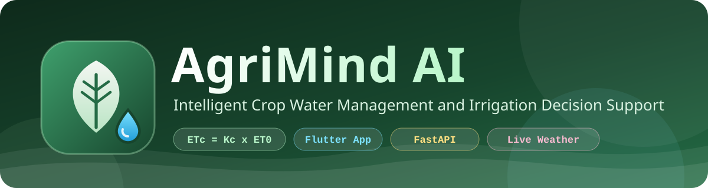
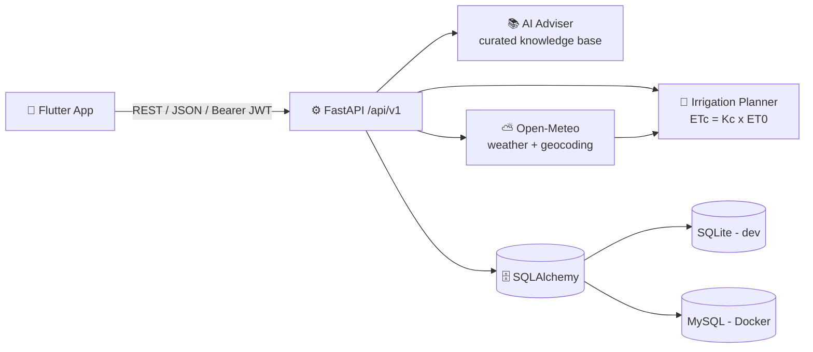

<div align="center">



<br/>

**Smart farming. Better decisions. Bigger harvests.**

<br/>


[🚀 Quick Start](#-quick-start) &nbsp;•&nbsp; [✨ Features](#-features) &nbsp;•&nbsp; [🏗️ Architecture](#%EF%B8%8F-architecture) &nbsp;•&nbsp; [🔌 API](#-api-reference) &nbsp;•&nbsp; [🧪 Tests](#-tests)

</div>


## 🌱 About

**AgriMind AI** is a cross-platform agricultural water-management app built with **Flutter** and **FastAPI**. It brings together farm and crop management, live weather, scientific irrigation calculations, dashboard insights and a source-grounded agricultural adviser, so farmers can decide *when* and *how much* to irrigate using data instead of guesswork.

> 💧 **The science behind it:** crop water need is estimated with the FAO-56 concept **`ETc = Kc × ET0`**, then adjusted for effective rainfall. `1 mm` over `1 ha` equals `10,000 L`.


## ✨ Features

| | Feature | What you get |
|:-:|---|---|
| 🔐 | **Accounts** | Registration, login, password change, profile and preference settings |
| 🚜 | **Farms** | Full CRUD, acres/hectares conversion, soil type, automatic geocoding, per-user data isolation |
| 🌾 | **Crops** | Crop CRUD with variety, planting date, growth stage and season; days-since-planting tracking |
| ⛅ | **Live weather** | Open-Meteo 5-day forecast, humidity, wind, rainfall and ET0 for each farm location |
| 💧 | **Irrigation planner** | Daily and weekly water estimates, confidence level, schedules, logs and saved recommendations |
| 📊 | **Insights** | Water-use ratio, crop distribution, weekly activity chart and smart tips |
| 🤖 | **AI Adviser** | Retrieval-based agricultural chat with cited sources; says so when it has no verified answer |
| 🗄️ | **Flexible storage** | SQLite for quick local development, MySQL 8 for Docker and production |


## 🧰 Technology Stack

<div align="center">


</div>

| Layer | Technology |
|---|---|
| 📱 **Frontend** | Flutter, Material 3, Dart |
| ⚙️ **Backend** | Python, FastAPI, SQLAlchemy, Pydantic |
| 🔑 **Authentication** | JWT bearer tokens, PBKDF2-SHA256 password hashing |
| 🗄️ **Databases** | SQLite (dev), MySQL 8 (Docker / production) |
| 🌦️ **Weather** | Open-Meteo geocoding and forecast APIs (no API key needed) |
| 🧪 **Testing** | pytest, FastAPI TestClient |


## 🏗️ Architecture




## 🚀 Quick Start

### ⚡ One-click launch (Windows)

Double-click **`run-agrimind.bat`** in the project root. It will:

1. ✅ check that Python and Flutter are installed
2. 🐍 create the backend virtual environment and install dependencies
3. 📝 create `backend/.env` with a fresh secret key (SQLite by default)
4. 🟢 start the API on `http://127.0.0.1:8000` in its own window and wait until it is healthy
5. 📱 run `flutter pub get` and launch the app on the target you choose

You pick the target from a menu: **Chrome**, **Windows desktop**, **Android**, or **backend only**.

> 💡 Once the backend window shows *"Application startup complete"*, Swagger docs are at <http://127.0.0.1:8000/docs>.

### 🛠️ Manual setup

<details>
<summary><b>1️⃣ Start the backend</b></summary>

```powershell
cd backend
py -m venv .venv
.\.venv\Scripts\Activate.ps1
py -m pip install -r requirements-dev.txt
Copy-Item .env.example .env
py -m uvicorn app.main:app --host 127.0.0.1 --port 8000 --reload
```

For SQLite, set `DATABASE_URL=sqlite:///./agrimind_dev.db` in `backend/.env`. Or simply run `.\backend\run-server.ps1`.

</details>

<details>
<summary><b>2️⃣ Start Flutter</b></summary>

```powershell
flutter pub get
flutter run
```

The app picks its API URL automatically:

| Platform | Base URL |
|---|---|
| 🤖 Android emulator | `http://10.0.2.2:8000/api/v1` |
| 🌐 Web, 🪟 Windows, 🐧 Linux, 🍎 macOS | `http://127.0.0.1:8000/api/v1` |

📲 **Physical Android device:** start the backend with `--host 0.0.0.0` and set the server URL to your PC's LAN IP from the login screen (⚙️ icon) or **Profile → Backend Server Connection**.

</details>

<details>
<summary><b>🐳 Docker + MySQL</b></summary>

```powershell
cd backend
Copy-Item .env.example .env
docker compose up --build
```

Compose starts **MySQL 8** on port `3306` and the **API** on port `8000`.

</details>


## 🔌 API Reference

Base URL: `http://<host>:8000/api/v1` &nbsp;|&nbsp; Interactive docs: `/docs` &nbsp;|&nbsp; Health check: `/health`

Authentication endpoints are public. Everything else needs `Authorization: Bearer <token>`.

| 📱 Screen | 🔗 Endpoints |
|---|---|
| 🔐 Login | `POST /auth/register` · `POST /auth/login` · `POST /auth/forgot-password` · `GET /auth/me` |
| 🏠 Dashboard | `GET /dashboard` |
| 🚜 Farms | `GET/POST /farms` · `GET/PUT/DELETE /farms/{id}` |
| 🌾 Crops | `GET/POST /crops` · `GET/PUT/DELETE /crops/{id}` |
| ⛅ Weather | `GET /weather?farm_id=` |
| 💧 Irrigation | `GET /irrigation/overview` · `POST /irrigation/logs` · `POST /irrigation/schedule` · `GET /irrigation/logs` · `POST/GET /irrigation/recommendations` |
| 📊 Insights | `GET /insights` |
| 🤖 AI Adviser | `GET /adviser/suggestions` · `POST /adviser/chat` |
| 👤 Profile | `GET/PATCH /profile` · `POST /auth/change-password` |

📖 Full endpoint contract: [`backend/docs/API.md`](backend/docs/API.md)


## 🧪 Tests

```powershell
# Backend (isolated in-memory SQLite, mocked weather)
cd backend
py -m pytest -q

# Flutter static analysis
flutter analyze
```


## ⚙️ Configuration

Settings live in `backend/.env`:

| Setting | Purpose | Default |
|---|---|---|
| `DATABASE_URL` | SQLAlchemy connection string | SQLite dev database |
| `SECRET_KEY` | JWT signing key | Development-only fallback |
| `ACCESS_TOKEN_EXPIRE_MINUTES` | Login session length | `10080` (7 days) |
| `CORS_ORIGINS` | Allowed browser origins | `*` |
| `TIMEZONE` | Application timezone | `Asia/Kolkata` |

> ⚠️ **Before deploying:** set a strong, unique `SECRET_KEY` and restrict `CORS_ORIGINS`.


## 📁 Project Layout

```text
AgriMind-AI/
├── 🪟 run-agrimind.bat          One-click launcher (Windows)
├── 📱 lib/                      Flutter application
│   ├── core/                    API service, storage, models, constants
│   └── features/                auth, dashboard, farms, crops, weather,
│                                irrigation, insights, ai_adviser, profile
├── ⚙️ backend/
│   ├── app/
│   │   ├── routers/             HTTP endpoints
│   │   ├── services/            weather, agronomy, irrigation, adviser
│   │   ├── database_models.py   SQLAlchemy models
│   │   └── api_schemas.py       Request / response validation
│   ├── tests/                   pytest suite
│   ├── docs/API.md              Endpoint contract
│   └── database_schema.sql      Reference MySQL schema
└── 🎨 assets/                   README logo and banner
```


## 🛠️ Troubleshooting

| 😟 Problem | ✅ Fix |
|---|---|
| `Python was not found` | Install Python 3.11+ and tick **Add python.exe to PATH** |
| `flutter is not recognized` | Install the Flutter SDK and add its `bin` folder to PATH |
| Port `8000` already in use | Close the other backend window, or free the port and relaunch |
| App says *Cannot connect to backend* | Check <http://127.0.0.1:8000/health>; on Android use `10.0.2.2` |
| Weather shows *unavailable* | Open-Meteo needs internet; the planner falls back to a default ET0 and lowers its confidence |


<br/>

<div align="center">


**Grow smarter. Save water. Harvest better.** 🌿💧

*Irrigation numbers are estimates meant for decision support, not a replacement for local agronomic advice.*

</div>
